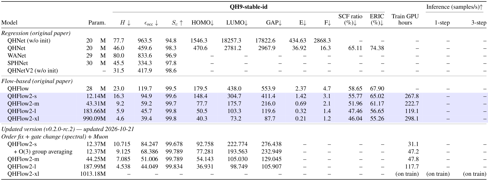

# QHFlow2

<!-- # High-order Equivariant Flow Matching for Density Functional Theory Hamiltonian Prediction (QHFlow) -->

By Seongsu Kim, Feb, 2026 [[PDF]](https://arxiv.org/pdf/2602.16897v1)

🌟 This repository contains an implementation of the QHFlow2 for DFT Hamiltonian prediction. This repository is still updating.

[Latest published release](https://github.com/seongsukim-ml/QHFlow2/releases/tag/v0.2.0-rc.1) · [Updated benchmarks](#qh9stable-benchmark-update) · [Stable/Muon training guide](docs/QH9STABLE_MUON.md) · [Version history](#version-history)

## Packages and Requirements

For the corrected SO(3)/O(3) models with Muon, use
[`requirements-stable-muon.txt`](requirements-stable-muon.txt) and the
[tested runtime instructions](docs/QH9STABLE_MUON.md#stable-data-and-runtime).
The installation examples below are retained for the **legacy** models;
their Torch 2.4 runtime does not provide native Muon.

```bash
# Example CUDA 12.1 with torch 2.4.1 without gpu-pyscf
conda create -n qhflow2 python=3.12 -y
conda activate qhflow2

pip install fairchem-core==2.6.0
pip install pyscf==2.10.0
pip install torch==2.4.1 torchvision==0.19.1 torchaudio==2.4.1 --index https://download.pytorch.org/whl/cu121
pip install torch_geometric==2.3.0
pip install pyg_lib torch_scatter torch_sparse torch_cluster torch_spline_conv -f https://data.pyg.org/whl/torch-2.4.0+cu121.html

pip install -r ../requirements.txt
```

```bash
# Example CUDA 12.1 with torch 2.4.1 with gpu-pyscf
conda create -n qhflow2-gpu-pyscf python=3.12 -y
conda activate qhflow2-gpu-pyscf
conda install cuda=12.4.0 -c nvidia

pip install nvidia-cuda-runtime-cu12==12.6.37
pip install gpu4pyscf-cuda12x
pip uninstall cupy
conda install cupy=13.4.0

pip install fairchem-core==2.6.0
pip install pyscf==2.10.0
pip install torch==2.4.1 torchvision==0.19.1 torchaudio==2.4.1 --index https://download.pytorch.org/whl/cu121
pip install torch_geometric==2.3.0
pip install pyg_lib torch_scatter torch_sparse torch_cluster torch_spline_conv -f https://data.pyg.org/whl/torch-2.4.0+cu121.html

pip install -r ../requirements.txt
```

**Note:** Run `pip install -r ../requirements.txt` from the `src/` directory (or `pip install -r requirements.txt` from the repository root).

Q tensor generation uses PySCF (`int3c1e`) with the original 16s/8p/4d auxiliary
basis defined in code. Psi4 and a working-directory `auxiliary.gbs` file are
not required. Existing Q tensor shapes and orbital ordering are preserved.

## Directory and Files
Current training and reproduction entrypoints are listed in [reproduce/README.md](reproduce/README.md).

```text
src/config_qh9/       Current release presets and original-checkpoint model definitions
src/experiment/       Training entrypoints (train_release for the updated version)
src/reproduction/     Checkpoint inference, molecule identity checks, SCF and DFT evaluation
reproduce/            Protocol YAMLs, molecule lists, provenance and commands
docs/                 Benchmarks, checkpoint metadata and release history
archive/              Earlier configs, evaluation scripts and experiment notebooks
```

The [archive index](archive/README.md) explains how to recover historical commands.
Archived configurations are excluded from the current training config search path.

## Dataset
Datasets are provided via Google Drive. Download and place each dataset folder under `dataset/`.

**MD17:** Pre-processed MD17 data (ethanol, malondialdehyde, uracil, etc.) is available on Google Drive: [md17_processed](https://drive.google.com/drive/folders/1d3HTu0H7gdg54kirWBqN24x-s1QW6OKV?usp=sharing). Download each folder and place it under `dataset/` (e.g. `dataset/ethanol/`, `dataset/malondialdehyde/`, `dataset/uracil/`).

**rMD17 (Revised MD17):** Pre-processed rMD17 data (rmd-aspirin, rmd-ethanol, rmd-naphthalene, rmd-salicylic_acid) is available on Google Drive: [new_md17 (rMD17)](https://drive.google.com/drive/folders/1yqxWmy2NM84Q_yjBnvQaZLO6vAAc5ghA). Download each folder and place it under `dataset/` (e.g. `dataset/rmd-aspirin/`, `dataset/rmd-ethanol/`, etc.).

**QH9:** Use the commands below:

```bash
mkdir -p ./dataset/QH9Stable/raw/
gdown https://drive.google.com/uc?id=1LcEJGhB8VUGkuyb0oQ_9ANJdSkky9xMS -O ./dataset/QH9Stable/raw/QH9Stable.db

mkdir -p ./dataset/QH9Dynamic_300k/raw/
gdown https://drive.google.com/uc?id=1sbf-sFhh3ZmhXgTcN2ke_la39MaG0Yho -O ./dataset/QH9Dynamic_300k/raw/QH9Dynamic_300k.db
```

Processing from raw files to torch datasets runs automatically on the first training run.
Or, you can process manually with the sharding process:
```bash
python -m dataset_module.qh9_datasets_split \
    --name=${NAME}  \
    --num_chunks=30 --chunk_idx=${DB_IDX} \
    --split=${SPLIT}
```
where NAME is the dataset name (`QH9Stable` / `QH9Dynamic`). Use the following SPLIT options:
- `QH9Stable`: `random`, `size_ood`
- `QH9Dynamic`: `geometry`, `mol`

Set `DB_IDX=-1` to process all shards, or use one shard index for a resumable
partial run. Each shard is written directly under `processed/lmdbs/`.
The command above remains as a compatibility CLI, but new Python code should
import from `dataset_module.qh9_dataset`. The following legacy import paths are
deprecated, emit `DeprecationWarning`, and retain their previous exports during
the compatibility period:

- `dataset_module.qh9_common`
- `dataset_module.qh9_datasets_split`
- `dataset_module.qh9_datasets_shard`
- `dataset_module.qh9_datasets_shard_full_process`

**Note:** We plan to provide pre-processed datasets for all datasets to facilitate easier setup and usage.

## Saved Checkpoints

Pre-trained checkpoints are available on **Google Drive**: [QHFlow checkpoints](https://drive.google.com/drive/folders/14My7LuvDJiM9hvG2n4_5T9UN97wp4x9w?usp=sharing). Download and place them under `ckpts/` (or set `ckpt` to the path where you saved them).

Dataset and split names used in checkpoint paths:
- **MD17**: `ethanol`, `malondialdehyde`, `uracil`, `water`
- **rMD17**: `rmd-aspirin`, `rmd-naphthalene`, `rmd-salicylic_acid`
- **QH9**: `QH9Stable`, `QH9Dynamic` with splits `random`, `size_ood` (QH9Stable) or `geometry`, `mol` (QH9Dynamic)

When running from `src/`, use the checkpoint path in the `ckpt` argument (e.g. `ckpt=../ckpts/...`).

## QH9Stable benchmark update

Updated **2026-10-21** · Updated version **[v0.2.0-rc.2](docs/releases/v0.2.0-rc.2-checkpoints.md)** (draft release).



- **Results and units.** Original-paper metrics, including QHNetV2, reproduce the supplied paper tables. QHFlow2 parameter counts follow the [checkpoint/config audit](docs/MODEL_CONFIGS.md); updated counts are trainable parameters (XL: initialized model). Updated results use the best validation checkpoint, seed 42, all **13,084** official QH9Stable random-split test molecules and **three ODE steps**. H, occupied orbital energies, HOMO, LUMO and GAP are in μEh; Sc is in percent. Original E/F values retain their source units; updated E/F and other unavailable values are shown as dashes.
- **Model update.** Order fix + **gate change (spectral)** + Muon at **1e-3**; norm, embedding and other unsupported parameters use AdamW at **1e-4**. Updated S/M also enable the Hamiltonian-input path. **+ O(3) group averaging** denotes a separately trained QHFlow2-O(3)-s, using shared-weight identity/inversion averaging. These results combine architecture and training changes and are not a single-change ablation.
- **Training cost.** Original QHFlow2 S/M/L/XL training GPU hours are reconstructed from W&B training-event histories, using one training GPU and effective batch 32 from published checkpoint configs. GPU hours sum retained session spans, including validation/checkpointing inside them, and exclude startup, restart gaps, overwritten training tails and later evaluation. Updated S/O(3)-S/M use one GPU and L uses two. Only updated XL displays `(on train)`. These are approximate observed costs. Original GPU-type metadata was overwritten by later evaluation, so training costs are not a matched-hardware optimization comparison. [Timing records and reproduction](reproduce/README.md#original-model-training-costs) preserve the method and sources.
- **Inference (samples/s)** has separate **1-step** and **3-step** columns. Measurements are pending an exclusive GPU; dashes mean unmeasured. The prepared protocol uses one H100 80GB, FP32 (high matmul precision), eager execution without torch.compile, batch 8, and the same fixed 128-molecule official test subset for all eight completed checkpoints. Actual flow sampling is timed separately at each step count after warmup, including the prior, geometry and Hamiltonian-block prediction; loading, device transfer, batch cloning, full-matrix assembly, accuracy metrics and DFT are excluded. Each O(3) molecule counts once. Training samples/s is retained only in historical evidence and is not used as inference speed. Accuracy columns remain three-step results. [Protocol and command](reproduce/README.md#inference-speed).
- **Display precision.** Updated H/orbital results are rounded from saved full-precision metrics to three decimal places; SCF ratio and ERIC use two decimal places. Original-paper accuracy retains its reported precision. More digits expose recorded differences and do not imply statistical significance. [Unrounded updated results](reproduce/benchmark/current-results.json).
- **SCF ratio and ERIC.** SCF ratio (%) is `100 × sum(N_model) / sum(N_MinAO)` (lower is better; MinAO = 100%). ERIC (%) is `100 × mean((N_model + 1) / N_MinAO)`, including one initial Hamiltonian build under the [ERIC accounting convention](https://arxiv.org/html/2604.21657v1#S4); it is not a wall-time speedup. The six available original-model entries are recomputed from the [300-molecule paired records](reproduce/scf/recorded-300-cycles.csv), on the same cohort as [original-paper Figure 4](https://arxiv.org/html/2602.16897v1#S4.F4), confirmed by the maintainer on 2026-10-21. ERIC is a new post-hoc calculation. The recovered March solver settings are retained in [provenance](reproduce/scf/provenance.json), including differences from Appendix E.4; these added columns are not transcribed paper-table values. Updated-model SCF metrics have not been evaluated and remain dashes. See the [reproducible summary](reproduce/scf/recorded-300-summary.json).
- **Checkpoint status.** S/O(3)-S/M/L each completed 260,000 steps; their packaged weights come from validation-selected step 258,409. XL is still training, with benchmark metrics and its checkpoint pending.

### Updated checkpoints

The four completed checkpoints are available now on
[Hugging Face](https://huggingface.co/ksusu/QHFlow2-QH9/tree/main/QH9Stable-random/v0.2.0-rc.2).
Each model folder contains unchanged inference weights, the exact saved training config,
metrics, provenance, license and checksums. Optimizer state is excluded.
GitHub archive copies remain in the **v0.2.0-rc.2 draft Release** pending review and publication.

| Model | Hugging Face weights |
| --- | --- |
| QHFlow2-s | [Download](https://huggingface.co/ksusu/QHFlow2-QH9/resolve/main/QH9Stable-random/v0.2.0-rc.2/QHFlow2-s/weights.ckpt) |
| QHFlow2-s + O(3) group averaging | [Download](https://huggingface.co/ksusu/QHFlow2-QH9/resolve/main/QH9Stable-random/v0.2.0-rc.2/QHFlow2-O3-s/weights.ckpt) |
| QHFlow2-m | [Download](https://huggingface.co/ksusu/QHFlow2-QH9/resolve/main/QH9Stable-random/v0.2.0-rc.2/QHFlow2-m/weights.ckpt) |
| QHFlow2-l | [Download](https://huggingface.co/ksusu/QHFlow2-QH9/resolve/main/QH9Stable-random/v0.2.0-rc.2/QHFlow2-l/weights.ckpt) |

See [checkpoint metadata and loading instructions](docs/releases/v0.2.0-rc.2-checkpoints.md).
The original 16 QH9 checkpoints remain available in the [same Hugging Face repository](https://huggingface.co/ksusu/QHFlow2-QH9/tree/main), alongside the Google Drive collection.

## Reproduction

Use the [reproduction guide](reproduce/README.md) for the current training presets,
checkpoint inference and the [SCF / energy-force protocol](reproduce/README.md#scf-and-dft-energyforces).
The five release presets match the recorded final S, O(3)-S, M, L and XL training configurations.
Muon starts at 1e-3 and AdamW at 1e-4; global batch size is 32.

For **Relative reduction of SCF cycles on QH9**, the
[molecule list](reproduce/scf/recorded-300.csv) links the 300 original-paper Figure 4
molecules to original QH9 indices and molecular formulas. The maintainer confirmed
on 2026-10-21 that the recovered March 2026 records use this same molecule list.
The [provenance note](reproduce/scf/provenance.json) records that confirmation,
geometry matches and the recovered solver settings.
The [paired cycle records](reproduce/scf/recorded-300-cycles.csv) cover six models.

DFT evaluation records explicit functional, basis, overlap policy, grid/gradient options,
input/checkpoint hashes, package versions, per-molecule results and failures.
Original-paper E/F values are preserved; this cleanup does not claim a new full-test evaluation.

## Version History

### [v0.2.0-rc.2](docs/releases/v0.2.0-rc.2-checkpoints.md) — updated 2026-10-21 (draft)

Completed Stable/Muon benchmarks and checkpoint bundles for QHFlow2-s/m/l and
QHFlow2-s + O(3) group averaging; XL is training on four GPUs. The benchmark
image reserves columns for training cost and throughput. Validated compute
optimizations and selective torch.compile preserve checkpoint state keys;
see the [compute report](docs/releases/v0.2.0-rc.2.md) and
[geometry follow-up](docs/releases/v0.2.0-rc.2-geometry.md).

The [checkpoint/config audit](docs/MODEL_CONFIGS.md) verifies every size's
width, depth and parameter counts. S/M/L layer counts are unchanged. The XL
preset now matches the published five-layer checkpoint architecture; older
four-layer XL weights require their saved configuration or an explicit
`model.num_gnn_layers=4` override. The `src/qhflow2_version.py --json` command
reports the source version and Git provenance.

### [v0.2.0-rc.1](https://github.com/seongsukim-ml/QHFlow2/releases/tag/v0.2.0-rc.1) — 2026-10-14

Code prerelease with the following updates:

- Replaced Psi4 with PySCF for Q-tensor generation.
- Added corrected SO(3) models and identity/inversion-averaged O(3) models in
  **s/m/l/xl** sizes, with end-to-end equivariance checks.
- Added QH9Stable random-split training configurations: Muon starts at **1e-3**;
  norm, embedding, and other non-matrix parameters use AdamW at **1e-4**.
- Added code-version and model metadata to new checkpoints. All model families
  are available in `main`; release tags pin the source and model configs select
  the architecture.

<details>
<summary>Equivariance correction and checkpoint compatibility</summary>

This release addresses a feature-ordering bug in the legacy eSCN-to-e3nn
interface that breaks rotational equivariance for multi-channel spherical
features. The bug arose in QHFlow2 while adapting feature conventions from prior
models. In follow-up experiments, we observed similar performance after
correcting the ordering issue; the updated Muon benchmarks above combine this correction with
spectral gating and optimizer changes.

The original model names and default configurations retain their behavior for
checkpoint reproducibility. The historical packing-only implementation,
`QHFlow_so2_v5_1_ordering_fixed`, remains available alongside the complete
corrected models `QHFlow2_order_fixed` and `QHFlow2_O3`. Legacy checkpoints
require their original model configuration; the corrected architectures require
new training.

See the [equivariance history and validation scope](docs/EQUIVARIANCE_STATUS.md)
and [release notes](docs/releases/v0.2.0-rc.1.md) for details.

</details>

### [ver.0.1.0](https://github.com/seongsukim-ml/QHFlow2/releases/tag/ver.0.1.0) — 2026-10-07

Historical code prerelease with the original model implementations. The tag and
source snapshot are preserved for reproducibility.

### Planned: v0.2.0

We plan to retrain **QHFlow2-s/m/l/xl (order-fixed)** and
**QHFlow2-O(3)-s/m/l/xl** with Muon on QH9Stable and release updated checkpoints
and detailed benchmark results. The training configurations are available in
`v0.2.0-rc.1`. S/M/L and O(3)-S now have completed benchmarks and draft checkpoint
bundles; XL is in progress. O(3)-M/L/XL benchmarks remain planned.

See the [full changelog](CHANGELOG.md) and
[versioning and release guide](docs/RELEASING.md).

## Citation
```
@inproceedings{kim2025high,
  title={High-order Equivariant Flow Matching for Density Functional Theory Hamiltonian Prediction},
  author={Kim, Seongsu and Kim, Nayoung and Kim, Dongwoo and Ahn, Sungsoo},
  booktitle={Advances in Neural Information Processing Systems},
  year={2025}
}
```

## Acknowledgements
This project is based on the repo [AIRS](https://github.com/divelab/AIRS.git) (QHNet).

**MD17 Dataset**: [Revised MD17 dataset (rMD17)](https://figshare.com/articles/dataset/Revised_MD17_dataset_rMD17_/12672038)

**QH9 Dataset**: [QHBench/QH9](https://github.com/divelab/AIRS/tree/main/OpenDFT/QHBench/QH9)

## License

QHFlow2 uses file-level licensing; see [LICENSE](LICENSE),
[REUSE.toml](REUSE.toml), and the [legal documentation](docs/legal/README.md).
Original QHFlow2 files are MIT, while identified AIRS/QHNet-derived software
remains GPL-3.0-only. CC-BY-NC-SA-4.0 applies only to QHFlow2 checkpoint weight
files trained on QH9, not to QHFlow2 source code. External datasets retain
their own upstream terms as listed in the
[dataset licensing guide](docs/legal/DATASETS.md).
